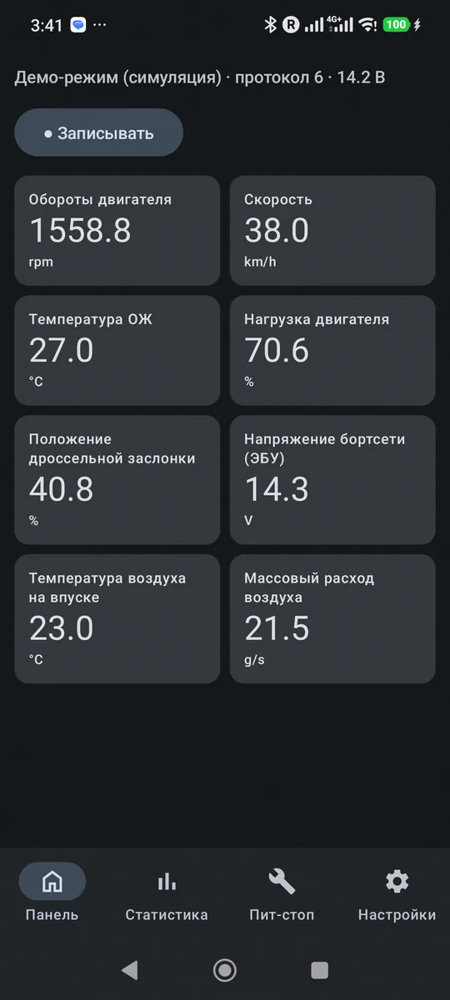
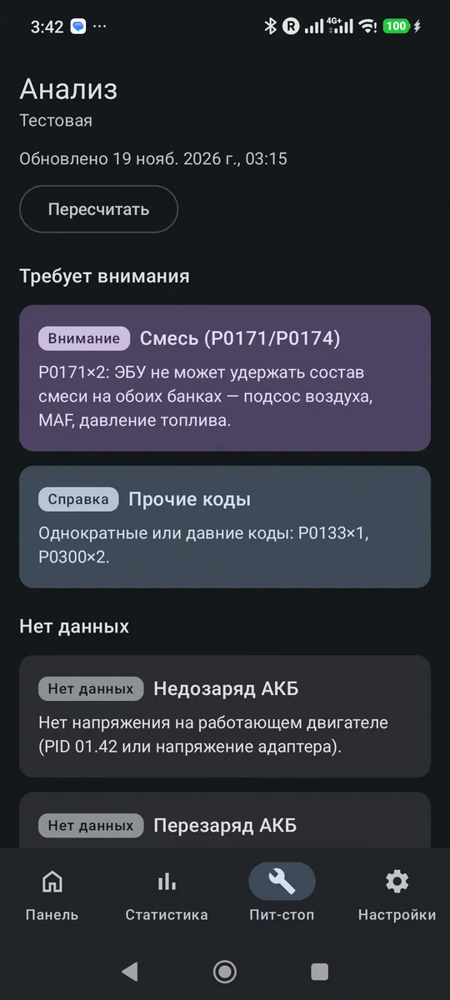
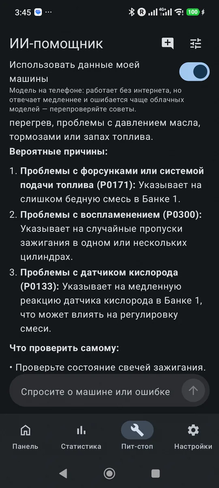
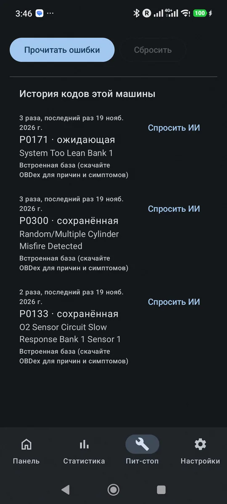
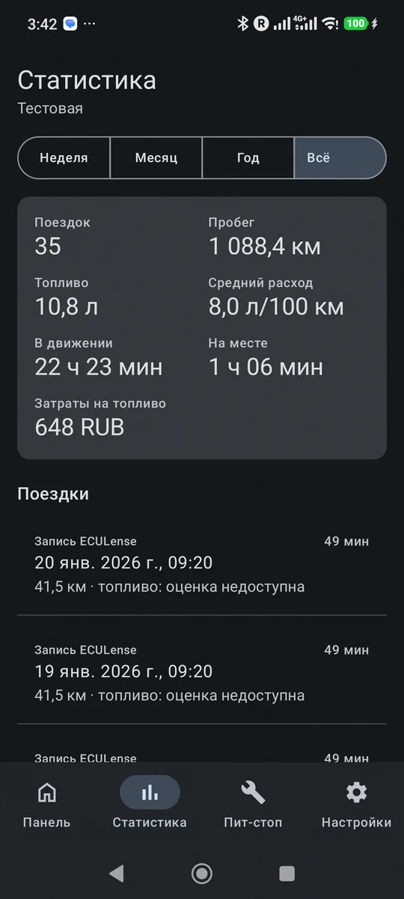
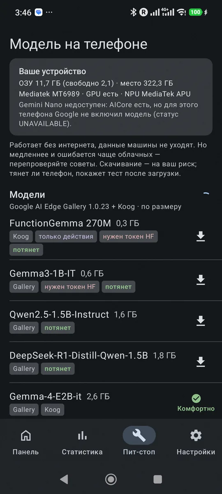

<p align="center">
  
</p>

<h1 align="center">ECULense</h1>

<p align="center">
  An OBD-II scanner for Android that doesn't just show numbers but helps you understand what's going on with your car.
</p>

<p align="center"><a href="README.md">Русский</a> · <b>English</b></p>

---

A typical scanner answers "which error code is set". ECULense tries to answer the next question: what those codes and sensor readings mean together, how urgent it is, and what to check first.

Plug in an inexpensive ELM327 adapter, watch live data, read and clear trouble codes, record your drives. The app searches the recordings for common problems (lean mixture, overheating, undercharging, repeated codes from one system) and shows them as findings backed by concrete numbers. You can ask the AI assistant about any finding. The AI never does the math: every number comes from the app, and the model only explains it using your data.

<p align="center">
  
  
  
</p>
<p align="center">
  
  
  
</p>
<p align="center"><sub>Screenshots taken with a debug build in demo mode with test data.</sub></p>

> **Status:** early version (0.1.0 plus the changes in the [CHANGELOG](CHANGELOG.md)). The protocol, connection recovery, diagnostics and the fuel log are covered by tests, the demo adapter and emulated misbehaving clones; field testing with a real adapter in a car is still ahead.
>
> **Language:** English and Russian. The app follows the system language; you can also pick one in Settings → Language (or in the system "App language" settings on Android 13+). The AI assistant answers in the app's language.

## What it does

**Diagnostics**
- Live standard PIDs: RPM, speed, coolant temperature, MAF, fuel trims, O2 sensors, voltage and more.
- Read and clear trouble codes with descriptions. A manufacturer-specific code is only described for your car's make: the same code means something else on another brand.
- Bluetooth, Wi-Fi and USB OTG adapters. Debug (developer) builds also have a demo mode with no adapter at all (including a "flaky clone" and an "engine stops" mode); regular builds don't.
- CAN and K-Line (ISO 9141 / KWP2000), so early-2000s cars work too, not just modern CAN ones. The car profile tells you when the car may predate mandatory OBD-II.
- Robust with cheap ELM327 clones: reconnect after a dropout, "engine off" instead of an error, priority polling (RPM and speed more often, slow sensors less often), a shareable adapter traffic log.
- Readiness monitors, a used-car "codes cleared recently?" check, freeze frame on the code card, safe clear with a before/after comparison, mode 06.
- A one-minute health check with traffic lights and an HTML/PDF report.

**Dashboard**
- Your own PID set per car, clear value states ("—", "~", "○", age), sparklines, a driving mode with big tiles and HUD.
- Trip warnings: overheating, not charging, a new trouble code, engine stall; a "Mark event" button.
- Auto-connect to the last adapter and automatic trip recording.
- A home-screen widget: live values, or the last battery voltage, code check and trip.

**Recordings and statistics**
- Record sessions, view charts, export to CSV.
- Trips are derived automatically: distance, fuel used, driving and idle time.
- A per-car summary: kilometres, litres, average consumption, fuel spend.
- A trip page with charts and a driving-style score; "engine maps": fuel trims by RPM and load, before/after comparison.
- Calibrating the harsh acceleration/braking threshold with the phone accelerometer in a rigid holder (optional, CSV export).

**Fuel and costs**
- A fuel log with full-to-full consumption, MAF estimate calibration, CSV import from Fuelio.
- All car expenses and cost of ownership per day, month and kilometre.

**Analysis and maintenance**
- Rules that find problems in recorded data: fuel trims and bank imbalance, overheating, battery undercharge, MAF at idle, repeated and related codes, distance driven with the check-engine light on.
- Background analysis after every trip, with a notification only when something new turns up.
- A maintenance plan with distance and time intervals, and current mileage estimated from your trips.

**AI assistant (optional)**
- A chat that reads your car's data on its own: code history, findings, sensor statistics, trips and monthly trends, maintenance.
- Questions go to experts (diagnostician, engine, electrical, usage analyst, fuel economist, service and more): each looks at its own data, and an editor writes one answer to the question you asked. Under the answer you see who worked on it and their notes. The on-device model answers in a single call "in all the needed roles at once" — several calls in a row are too slow on a phone.
- Any provider from the [Koog](https://github.com/JetBrains/koog) presets (OpenRouter, OpenAI, Anthropic, Google, DeepSeek, Mistral, Ollama) or your own OpenAI-compatible server.
- A model running on the phone itself (the "Local" build). Before downloading, the app estimates whether your device can handle it; after downloading, it runs a benchmark and shows the real speed.

**Moving from Car Scanner**
- Import of a full `.cbz` backup: recordings, trips and statistics, trouble-code events, the car profile. Re-importing adds only what's new, so you can use both apps side by side for a while.
- ECULense's own `.eculense` backup with restore.

**Reference data on demand**
- Vehicle specs (make, model, generation, engine): fill in the car profile in a couple of taps.
- Detailed trouble-code descriptions with causes and symptoms.
- Everything is downloaded separately, so the APK stays small.

## Privacy

- Your data stays on the phone. No accounts, no analytics.
- Only what you send to the AI assistant goes to the cloud, and only after explicit consent. VIN and GPS are never included in model requests.
- API keys are encrypted with Android Keystore and never end up in backups.
- Without the AI assistant the app works fully offline (the network is only used to download reference data).
- The demo adapter and log replay (debug builds only) never write into your car's history. The VIN is hidden by default.
- "Report a problem" opens a GitHub form only after showing the exact text; it has no VIN, car name, location or traffic log, and nothing is sent automatically.

## Installation

Ready-made APKs are on the [Releases](../../releases) page; per-commit builds are the `apk-release` artifact on the [Actions](../../actions) tab. There are two builds of the same app:

| Build | Size | For whom |
|---|---|---|
| **Cloud** (`cloud`) | ≈ 10 MB | AI through a cloud provider or your own server |
| **Local** (`local`) | ≈ 35 MB | the same plus models running on the phone (LiteRT runtime) |

Requires Android 8.0 or newer and an ELM327 v1.5+ adapter. Cheap clones labelled "v2.1" are often unreliable.

---

## For developers

### Building

You need JDK 17+ (CI uses 21) and the Android SDK.

```bash
./gradlew build                          # everything: both flavors, unit tests, lint
./gradlew :app:installLocalDebug         # install on a connected phone
./gradlew :core:obd:test                 # protocol tests, no phone or emulator needed
./gradlew :app:assembleCloudRelease :app:assembleLocalRelease
```

A full build needs about 4 GB of Gradle heap; this is already set in `gradle.properties`.

Releasing: add a version section to [CHANGELOG.md](CHANGELOG.md) and push a tag (`git tag 0.2.0 && git push origin 0.2.0`). CI builds both APKs, signs them with the key from the repository secrets and creates a draft release with notes from the changelog (`.github/workflows/release.yml`).

### How it's built

Kotlin, Jetpack Compose (Material 3), Navigation 3, Koin, Room, DataStore, WorkManager. All LLM providers go through [Koog](https://github.com/JetBrains/koog).

The architecture rests on three rules:

1. **Features don't know about each other.** Each `feature:*` module registers its screens in Koin (`navigation<Key>`) and declares where it appears: as a tab (`TopLevelEntry`) or as an entry in the "Pit stop" or "Settings" hub (`HubEntry`). Cross-feature navigation goes only through keys in `:core:navigation`. Any feature, including all AI modules at once, can be removed from `settings.gradle.kts` and the app still builds.
2. **The protocol is pure JVM.** `:core:obd` has no Android dependencies: ELM327, response parsing, CAN and K-Line, multi-frame responses, trouble codes. Its tests run in seconds against a fake transport from `testFixtures`. Bluetooth, TCP and USB are thin adapters over one transport interface.
3. **Code computes, the model explains.** Analysis (`:core:analytics`) is deterministic and tested. The AI sees data only through read-only tools (`:core:aitools`) and doesn't invent numbers.

```
app                       navigation root, cloud / local flavors
core/
  obd                     ELM327 / OBD-II protocol (pure JVM)
  bluetooth, usb          transports
  service                 foreground service for connection and polling
  database, data          Room and repositories
  analytics               statistics, rules, maintenance
  carscanner              Car Scanner backup reader (.cbz, .brc)
  backup                  background import and ECULense backups
  datapacks               on-demand reference data downloads
  vehicledb, dtcdb, obdb  reference data: vehicles, trouble codes, extended PIDs
  ai, aitools             LLMs via Koog, tools exposing the car's data
  ailocal                 on-device models (local build only)
  analyticstext, obdtext  localized texts for findings, OBD errors and PID names
  background              background analysis and notifications
  sensors                 phone accelerometer during recordings (threshold calibration)
  demo                    adapter emulator for working without a car (debug builds only)
  navigation, ui, model   shared navigation keys, theme, models
feature/                  screens: dashboard, connect, obdlog, cardata, dtc, health,
                          sessions, stats, fuel, analysis, maintenance, car, pitstop,
                          settings, datapacks, backup, widget, aisettings, aichat
build-logic/              convention plugins (ecu.android.feature and others)
```

### Adding a feature

1. Create `feature/<name>` with the `ecu.android.feature` plugin.
2. Declare the screen key in `:core:navigation`: `@Serializable data object …Destination : NavKey`.
3. In the feature's Koin module, register `navigation<…Destination> { … }` and a `HubEntry` or `TopLevelEntry`.
4. Include the module in `settings.gradle.kts` and in `app`.
5. Put UI text in the module's `res/values/strings.xml` (English) and `res/values-ru/strings.xml` (Russian); ViewModels hold `UiText`, pure-JVM modules return types, not text. `NoCyrillicLiteralsTest` and lint (`MissingTranslation`) fail the build on a hardcoded or untranslated string.

You shouldn't need to import other features' classes. If you do, `core` is missing a key or an interface.

### Working without a car

In a debug build (`installLocalDebug`/`installCloudDebug`) the bottom of the adapter list has a collapsed "For development" section: "Demo mode" (an ELM327 emulator with CAN, 23 PIDs and a few trouble codes), "flaky clone", "engine stops", the PC emulator and log replay. Release builds contain neither `:core:demo` nor these entries. For the Car Scanner import, tests have `BrcWriter`, which builds synthetic `.brc` and `.cbz` files. Real backups are never committed: they contain GPS tracks.

### Data and licences

Only the basic code descriptions (lennykean, MIT) are bundled in the APK. All other reference data is downloaded at the user's request from the original releases, unmodified:

| Data | Source | Licence |
|---|---|---|
| Vehicle specs | [gor3a/vehicle-makes-models](https://github.com/gor3a/vehicle-makes-models) | ODbL 1.0 (data), MIT (code) |
| Generic trouble codes, causes, symptoms | [foerbsnavi/OBDex](https://github.com/foerbsnavi/obdex) | CC0 |
| Manufacturer trouble codes | [Wal33D/dtc-database](https://github.com/Wal33D/dtc-database) | MIT |
| Extended PIDs | [OBDb](https://github.com/OBDb) | CC BY-SA 4.0 |
| Bundled code descriptions | [lennykean/OBDII.DTC](https://github.com/lennykean/OBDII.DTC) | MIT |
| On-device model catalog | [Google AI Edge Gallery](https://github.com/google-ai-edge/gallery) | Apache 2.0 |

The project is licensed under [Apache 2.0](LICENSE). Reference data keeps its own licences, listed above.
