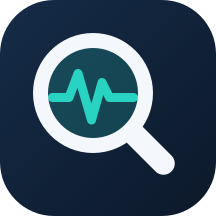
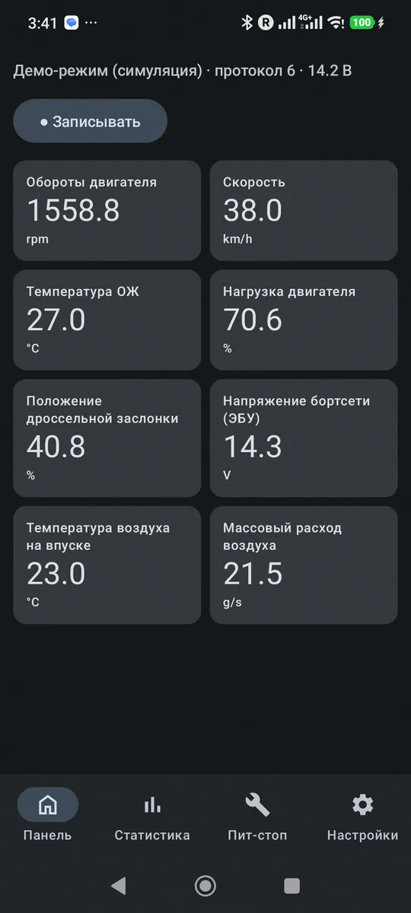
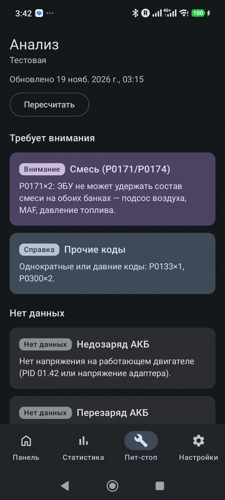
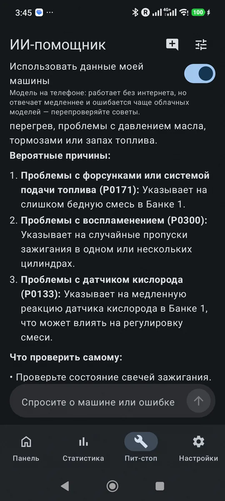
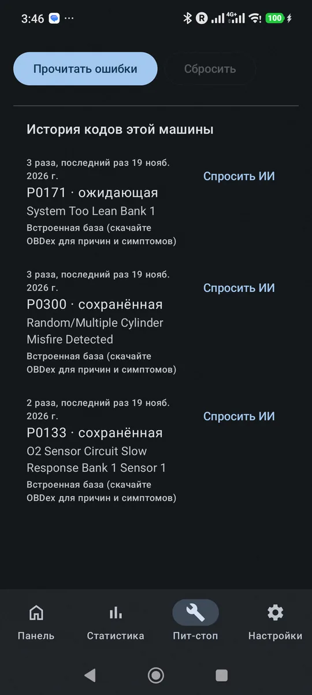
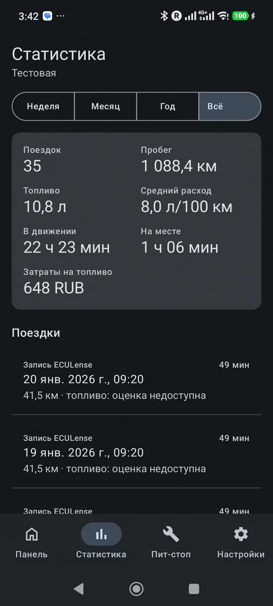
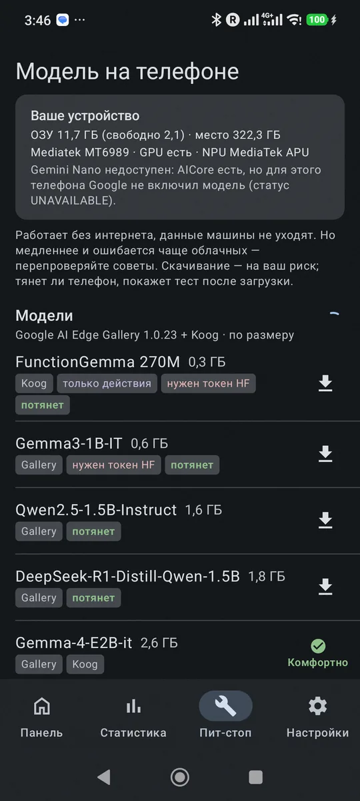

<p align="center">
  
</p>

<h1 align="center">ECULense</h1>

<p align="center">
  OBD-II сканер для Android, который не только показывает цифры, но и помогает понять, что с машиной.
</p>

<p align="center"><b>Русский</b> · <a href="README.en.md">English</a></p>

---

Обычный сканер отвечает на вопрос «какой код ошибки». ECULense пытается ответить на следующий: что эти коды и показания датчиков значат вместе, насколько это срочно и что проверить первым.

Подключаете недорогой ELM327-адаптер, смотрите живые данные, читаете и сбрасываете ошибки, записываете поездки. Приложение само ищет в записях типовые проблемы (бедная смесь, перегрев, недозаряд, повторяющиеся коды одной системы) и показывает их как находки с конкретными цифрами. По любой находке можно спросить ИИ-помощника. Сам ИИ при этом ничего не считает: все числа даёт приложение, а модель только объясняет их по вашим данным.

<p align="center">
  
  
  
</p>
<p align="center">
  
  
  
</p>
<p align="center"><sub>Скриншоты сняты отладочной сборкой в демо-режиме и на тестовых данных.</sub></p>

> **Статус:** ранняя версия (0.1.0 + изменения из [CHANGELOG](CHANGELOG.md)). Протокол, восстановление связи, диагностика и журнал заправок проверены тестами, демо-адаптером и эмуляцией капризных клонов; полевые испытания с реальным адаптером на машине ещё впереди.
>
> **Язык:** английский и русский. Приложение берёт язык системы, его можно сменить в Настройки → Язык (или в системных настройках «Язык приложения» на Android 13+). ИИ-помощник отвечает на языке приложения.

## Что умеет

**Диагностика**
- Живые показания стандартных PID: обороты, скорость, температура ОЖ, MAF, топливные коррекции, лямбда-зонды, напряжение и другие.
- Чтение и сброс ошибок с расшифровкой. Расшифровка заводского кода показывается только для марки вашей машины: тот же код у другой марки означает другое.
- Адаптеры по Bluetooth, Bluetooth LE, Wi-Fi и USB OTG. Bluetooth LE (OBDLink CX, Vgate, Viecar 4.0 и клоны с FFF0/FFE0/Nordic UART) и привязка сокета к Wi-Fi адаптера (ИИ и загрузки идут через мобильную сеть) реализованы, но на реальном адаптере ещё не проверены. В отладочной сборке (для разработчиков) есть демо-режим без адаптера, в том числе «капризный клон» и «двигатель глохнет»; в обычной сборке его нет.
- CAN и K-Line (ISO 9141 / KWP2000): работают и машины начала 2000-х, а не только новые. Подсказка в профиле, если машина старше обязательного OBD-II.
- Устойчивая связь с дешёвыми клонами ELM327: переподключение после обрыва, «двигатель выключен» вместо ошибки, приоритетный опрос (обороты и скорость чаще, медленные датчики реже), журнал обмена с адаптером, которым можно поделиться.
- Готовность систем, проверка «коды недавно стирали?» для б/у машины, стоп-кадр на карточке кода, безопасный сброс со сравнением «до / после», режим 06.
- «Блоки машины»: коды коробки, ABS/ESC и других блоков (CAN и K-Line KWP2000), только читающие запросы, подушки безопасности не опрашиваются. Реализовано, на настоящей машине ещё не проверено.
- «Проверка за минуту» со светофором и отчётом HTML/PDF.

**Панель**
- Свой набор PID для каждой машины, понятные состояния значений («—», «~», «○», возраст), спарклайны, режим езды с крупными плитками и HUD.
- Предупреждения в поездке: перегрев, нет зарядки, новый код ошибки, остановка двигателя; кнопка «Отметить событие».
- Автоподключение к последнему адаптеру и автозапись поездок.
- Виджет на домашний экран: живые значения или последнее напряжение АКБ, проверка кодов и поездка.

**Записи и статистика**
- Запись сессий, графики, экспорт в CSV.
- Поездки считаются автоматически: пробег, расход, время в движении и на месте.
- Сводка по машине: километры, литры, средний расход, траты на топливо.
- Страница поездки с графиками и оценкой стиля вождения; «карты двигателя» — топливные коррекции по оборотам и нагрузке, сравнение «до / после».
- Калибровка порогов резких разгонов и торможений по акселерометру телефона в жёстком держателе (по желанию, экспорт CSV).

**Заправки и расходы**
- Журнал заправок с расходом «от полного до полного», калибровка оценки по MAF, импорт CSV из Fuelio.
- Все траты на машину и стоимость владения в день, месяц и на километр.

**Анализ и обслуживание**
- Правила, которые находят проблемы в записях: топливные коррекции и разница банков, перегрев, недозаряд АКБ, MAF на холостых, повторяющиеся и связанные коды, пробег с горящим Check Engine.
- Фоновый анализ после каждой поездки. Уведомление приходит, только если нашлось что-то новое.
- План ТО с интервалами по пробегу и времени, оценка текущего пробега по поездкам.

**ИИ-помощник (по желанию)**
- Чат, который сам читает данные машины: историю ошибок, находки, статистику датчиков, поездки и тренды по месяцам, ТО.
- Вопрос разбирают эксперты (Диагност, Моторист, Электрик, Аналитик эксплуатации, Экономист, Мастер ТО и другие): каждый смотрит свои данные, редактор собирает один ответ на заданный вопрос. Под ответом видно, кто над ним работал, и их заметки. Модель на телефоне отвечает одним вызовом «сразу в нужных ролях» — несколько вызовов подряд на телефоне слишком долгие.
- Любой провайдер из пресетов [Koog](https://github.com/JetBrains/koog) (OpenRouter, OpenAI, Anthropic, Google, DeepSeek, Mistral, Ollama) или свой OpenAI-совместимый сервер.
- Модель на самом телефоне (сборка «Локально»). До скачивания приложение оценивает, потянет ли её устройство, после — прогоняет бенчмарк и честно показывает скорость.

**Переезд из Car Scanner**
- Импорт полного бэкапа `.cbz`: записи, поездки и статистика, события ошибок, профиль машины. Повторный импорт добавляет только новое, так что какое-то время можно пользоваться обоими приложениями.
- Своя резервная копия `.eculense` с восстановлением.

**Справочники по запросу**
- Характеристики машин (марка, модель, поколение, двигатель): профиль машины заполняется в пару касаний.
- Подробные описания кодов ошибок с причинами и симптомами.
- Всё скачивается отдельно, поэтому APK остаётся маленьким.

## Приватность

- Данные хранятся только на телефоне. Аккаунтов и аналитики нет.
- В облако уходит только то, что вы сами отправили ИИ-помощнику, и только после явного согласия. VIN и GPS в запросы к модели не попадают.
- API-ключи шифруются Android Keystore и не попадают в резервные копии.
- Без ИИ-помощника приложение работает полностью офлайн (сеть нужна только для скачивания справочников).
- Демо-адаптер и воспроизведение журнала (только в отладочной сборке) ничего не записывают в историю вашей машины. VIN скрыт по умолчанию.
- «Сообщить о проблеме» открывает форму на GitHub только после показа точного текста; VIN, названия машины, местоположения и журнала обмена в нём нет, ничего не отправляется само.

## Установка

Готовые APK — на странице [Releases](../../releases), сборки для каждого коммита — артефакт `apk-release` во вкладке [Actions](../../actions). Сборок две, это одно и то же приложение:

| Сборка | Размер | Для кого |
|---|---|---|
| **Облако** (`cloud`) | ≈ 10 МБ | ИИ через облачного провайдера или свой сервер |
| **Локально** (`local`) | ≈ 35 МБ | то же плюс модели прямо на телефоне (движок LiteRT) |

Нужен Android 8.0 или новее и адаптер ELM327 v1.5+. Дешёвые клоны с надписью «v2.1» часто работают нестабильно.

---

## Для разработчиков

### Сборка

Нужны JDK 17+ (CI использует 21) и Android SDK.

```bash
./gradlew build                          # всё: оба флейвора, unit-тесты, lint
./gradlew :app:installLocalDebug         # поставить на подключённый телефон
./gradlew :core:obd:test                 # тесты протокола, без телефона и эмулятора
./gradlew :app:assembleCloudRelease :app:assembleLocalRelease
```

Полной сборке нужно около 4 ГБ памяти под Gradle, это уже прописано в `gradle.properties`.

Релиз: добавьте раздел версии в [CHANGELOG.md](CHANGELOG.md) и запушьте тег (`git tag 0.2.0 && git push origin 0.2.0`). CI соберёт обе APK, подпишет ключом из секретов репозитория и создаст черновик релиза с заметками из ченджлога (`.github/workflows/release.yml`).

### Как устроено

Kotlin, Jetpack Compose (Material 3), Navigation 3, Koin, Room, DataStore, WorkManager. Все LLM-провайдеры идут через [Koog](https://github.com/JetBrains/koog).

Архитектура держится на трёх правилах:

1. **Фичи не знают друг о друге.** Каждый модуль `feature:*` регистрирует свои экраны в Koin (`navigation<Key>`) и сам объявляет, где появиться: вкладкой (`TopLevelEntry`) или пунктом в хабе «Пит-стоп» или «Настройки» (`HubEntry`). Переходы между фичами идут только через ключи из `:core:navigation`. Любую фичу, в том числе все ИИ-модули разом, можно убрать из `settings.gradle.kts`, и приложение соберётся.
2. **Протокол на чистом JVM.** `:core:obd` не зависит от Android: ELM327, разбор ответов, CAN и K-Line, многокадровые ответы, коды ошибок. Его тесты идут за секунды на фейковом транспорте из `testFixtures`. Bluetooth, TCP, USB и BLE (через чистый интерфейс `GattLink`) — тонкие адаптеры к одному интерфейсу транспорта.
3. **Числа считает код, объясняет модель.** Анализ (`:core:analytics`) детерминированный и покрыт тестами. ИИ получает данные только через read-only инструменты (`:core:aitools`) и не придумывает цифры.

```
app                       корень навигации, флейворы cloud / local
core/
  obd                     протокол ELM327 / OBD-II (чистый JVM)
  bluetooth, ble, wifi, usb  транспорты (wifi: сокет в сети адаптера)
  service                 foreground-сервис подключения и опроса
  database, data          Room и репозитории
  analytics               статистика, правила, ТО
  carscanner              чтение бэкапов Car Scanner (.cbz, .brc)
  backup                  фоновый импорт и своя резервная копия
  datapacks               скачивание справочников по запросу
  vehicledb, dtcdb, obdb  справочники: машины, коды ошибок, расширенные PID
  ai, aitools             LLM через Koog, инструменты с данными машины
  ailocal                 модели на телефоне (только сборка local)
  analyticstext, obdtext  локализованные тексты находок, ошибок OBD и названий PID
  background              фоновый анализ и уведомления
  sensors                 акселерометр телефона во время записи (калибровка порогов)
  demo                    эмулятор адаптера для работы без машины (только debug-сборки)
  navigation, ui, model   общие ключи навигации, тема, модели
feature/                  экраны: dashboard, connect, obdlog, cardata, dtc, health,
                          sessions, stats, fuel, analysis, maintenance, car, pitstop,
                          settings, datapacks, backup, widget, aisettings, aichat
build-logic/              convention-плагины (ecu.android.feature и др.)
```

### Как добавить фичу

1. Создайте `feature/<name>` с плагином `ecu.android.feature`.
2. Объявите ключ экрана в `:core:navigation`: `@Serializable data object …Destination : NavKey`.
3. В Koin-модуле фичи зарегистрируйте `navigation<…Destination> { … }` и `HubEntry` или `TopLevelEntry`.
4. Подключите модуль в `settings.gradle.kts` и в `app`.
5. Тексты интерфейса — в `res/values/strings.xml` модуля (английский) и `res/values-ru/strings.xml` (русский); ViewModel держит `UiText`, чистые JVM-модули возвращают типы, а не текст. `NoCyrillicLiteralsTest` и lint (`MissingTranslation`) валят сборку на строке в коде или без перевода.

Импортировать классы других фич не нужно. Если без этого не обойтись, в `core` не хватает ключа или интерфейса.

### Разработка без машины

В отладочной сборке (`installLocalDebug`/`installCloudDebug`) внизу списка адаптеров есть свёрнутый раздел «Для разработки»: «Демо-режим» (эмулятор ELM327 с CAN, 23 PID и несколькими кодами ошибок), «капризный клон», «двигатель глохнет», эмулятор на ПК и воспроизведение журнала. В release-сборку модуль `:core:demo` и эти пункты не попадают. Для импорта Car Scanner в тестах есть `BrcWriter`, он собирает синтетические `.brc` и `.cbz`. Настоящие бэкапы в репозиторий не коммитим: в них GPS-треки.

### Данные и лицензии

В APK встроены только базовые описания кодов (lennykean, MIT). Остальные справочники приложение скачивает по запросу пользователя из исходных релизов, без изменений:

| Данные | Источник | Лицензия |
|---|---|---|
| Характеристики машин | [gor3a/vehicle-makes-models](https://github.com/gor3a/vehicle-makes-models) | ODbL 1.0 (данные), MIT (код) |
| Общие коды ошибок, причины, симптомы | [foerbsnavi/OBDex](https://github.com/foerbsnavi/obdex) | CC0 |
| Заводские коды ошибок | [Wal33D/dtc-database](https://github.com/Wal33D/dtc-database) | MIT |
| Расширенные PID | [OBDb](https://github.com/OBDb) | CC BY-SA 4.0 |
| Встроенные описания кодов | [lennykean/OBDII.DTC](https://github.com/lennykean/OBDII.DTC) | MIT |
| Каталог моделей для телефона | [Google AI Edge Gallery](https://github.com/google-ai-edge/gallery) | Apache 2.0 |

Лицензия проекта — [Apache 2.0](LICENSE). У справочников свои лицензии, они указаны в таблице выше.
